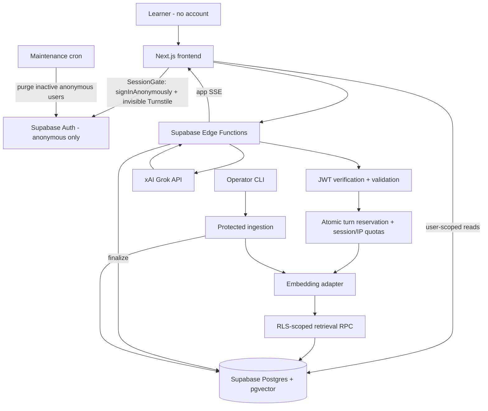

# CodeBloom Architecture

## Trust boundaries
| Boundary | Rule |
|---|---|
| Browser -> Auth | anonymous sign-in only; CAPTCHA + per-IP rate limit |
| Browser -> Edge | untrusted input; verified JWT required |
| Edge -> Postgres | least privilege |
| Retrieved content -> Prompt | reference data, not instructions |
| Edge -> xAI | minimum necessary context |
| xAI -> Browser | validate events, sanitize rendering |
| Operator -> Ingestion | separate privileged credential, never from the browser |

## Responsibilities
Frontend: rendering, silent session creation, drafts, stream consumption, accessible status, optimistic UI with reconciliation, user-scoped caching. It never decides authorization, model, system prompt or limits, and never shows a login screen.
Backend: identity verification, authorization, validation, reservation, quotas (session + hashed IP + global), context, retrieval, provider calls, event normalization, finalization, cancellation, reconciliation, data deletion, inactivity purge.
Database: durable state, ownership, RLS, atomic reservation, idempotency, usage counters, vector search, cascading deletion.

## Privileged access
Use an admin client only for: trusted assistant output, usage records, approved content processing, data deletion (auth user removal), inactivity purge, stale-request reconciliation. Recheck ownership/operator authorization in every privileged operation.

## Deployment boundaries
Frontend deployed independently; Edge Functions on Supabase; migrations before compatible functions; ingestion independent of chat; no cross-user provider-response cache.

## ADRs
1. Supabase as backend (no separate Express/FastAPI for MVP).
2. Stateless provider conversations; history in Postgres.
3. No execution environment; explain code without running it.
4. Curated retrieval, not open browsing.
5. Application-owned streaming protocol.
6. **No accounts in v1: Supabase anonymous sessions.** Keeps RLS/JWT model intact with zero login friction. Trade-offs: history is per-browser; anonymous identities are cheap, so CAPTCHA, per-IP quotas and a global spend breaker are mandatory; inactive data is purged.
