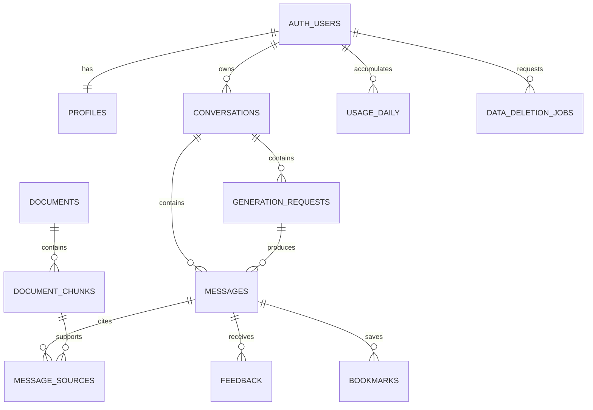

# CodeBloom Database Specification

Supabase Postgres stores app data; pgvector stores embeddings (derived data tied to source, model and preprocessing version). Every learner is an **anonymous** `auth.users` row (`is_anonymous = true`); the schema treats it like any user.

## Tables
**profiles**: id (PK, ref auth.users ON DELETE CASCADE), preferred_language (python|javascript|typescript|sql|html_css), explanation_language (en|roman_ur), experience_level (new|basics|comfortable), explanation_depth (concise|detailed), enter_to_send (bool, default true), reduce_motion (bool, default false), onboarded_at (nullable), last_active_at, created_at, updated_at. Created by an `AFTER INSERT ON auth.users` trigger (SECURITY DEFINER, `search_path = ''`) with defaults. No display name, email or any personal identifier. No admin flags.

**conversations**: id, user_id, title (bounded), language, mode (explain|debug|practice), created_at, updated_at. UNIQUE(id,user_id) for composite child FKs.

**generation_requests**: id (public turn id), user_id, conversation_id, idempotency_key, request_hash, status, lease_expires_at, cancel_requested_at, provider_request_id, prompt_version, model, input_tokens, output_tokens, reasoning_tokens, cost_amount, cost_currency, error_code, ip_bucket (HMAC, nullable), created_at, completed_at. UNIQUE(user_id,idempotency_key); composite FK(conversation_id,user_id); partial unique indexes on active request per user and per conversation; status in accepted|retrieving|streaming|completed|failed|interrupted|incomplete. Reconcile expired leases before new reservations.

**messages**: id, user_id, conversation_id, generation_request_id, role (user|assistant), content (bounded), status, created_at. UNIQUE(generation_request_id, role); no browser insert/update grants; order by created_at,id.

**documents**: id, title, source_url, source_version, programming_language, license_note, content_hash, status (draft|indexing|published|archived|failed), embedding_model, embedding_version, published_at, created_at. Learners read published only.

**document_chunks**: id, document_id, chunk_index, heading, content, token_count, embedding vector(384), metadata jsonb. UNIQUE(document_id,chunk_index). Never mix embedding models in one search space.

**message_sources**: message_id, chunk_id, document_title, source_url, document_version, citation_label; PK(message_id, citation_label).

**feedback**: id, user_id, message_id, rating (helpful|not_helpful), reason, created_at; UNIQUE(user_id,message_id); owner of the assistant message only.

**bookmarks**: user_id, message_id, created_at; PK(user_id,message_id); completed own assistant messages only.

**usage_daily**: user_id, usage_date (UTC), accepted_turns, input_tokens, output_tokens, reasoning_tokens, unknown_usage_turns; PK(user_id,usage_date); no browser writes.

**usage_ip_daily** (new): ip_bucket (HMAC-SHA256 of client IP with IP_HASH_SALT, text), usage_date, accepted_turns; PK(ip_bucket, usage_date). Service-only; never exposed to browsers; rows older than 7 days purged. Raw IPs are never stored.

**usage_global_daily** (new): usage_date PK, accepted_turns, estimated_cost; drives the spend breaker. Service-only.

**data_deletion_jobs** (new): id, user_id (not FK, survives deletion), status (requested|running|completed|failed), requested_at, completed_at, error_code. Holds no content.

## Indexes
conversations(user_id, updated_at DESC, id); messages(conversation_id, created_at, id); generation_requests(user_id, created_at DESC); generation_requests(status, lease_expires_at); profiles(last_active_at); document_chunks(document_id); documents(status, programming_language); feedback(user_id); bookmarks(user_id, created_at DESC); HNSW on document_chunks.embedding with vector_cosine_ops (exact search is fine for a small corpus).

## Access matrix
| Table | Browser (anonymous `authenticated` JWT) | Trusted backend |
|---|---|---|
| profiles | own SELECT + validated UPDATE of preference columns | create (trigger), last_active_at, purge |
| conversations | own SELECT | controlled mutations |
| messages | own SELECT | controlled INSERT/UPDATE |
| generation_requests | own SELECT (no ip_bucket column via view) | lifecycle |
| documents / document_chunks | published SELECT | ingestion |
| message_sources | own-message SELECT | citation writes |
| feedback / bookmarks | own SELECT | validated mutation |
| usage_daily | optional read-only own view | counter updates |
| usage_ip_daily / usage_global_daily / data_deletion_jobs | none | service only |
Requests without a verified JWT (role `anon`) get nothing.

## RLS requirements
Enable RLS on every exposed table; revoke default anon/authenticated grants then grant back minimum; policies scoped `to authenticated`; USING and WITH CHECK on updates; ownership from `(select auth.uid())`, never from request body; owners cannot reassign ownership; index ownership columns. Anonymous users carry role `authenticated` — do not write policies that rely on a permanent account, and do not special-case `is_anonymous` for data access (only for abuse rules if needed). Views must use security_invoker=true. Add pgTAP tests (supabase/tests) for allow and deny per operation using two anonymous identities plus `anon`.

## Retrieval RPC: match_document_chunks
Inputs: query vector, optional language filter, bounded count, min similarity. Returns chunk id, document id, heading, content, source URL, title, version, similarity. SECURITY INVOKER; schema-qualified; published documents and matching embedding version only; clamp result count; revoke PUBLIC execute; grant to authenticated + required service roles. Similarity is a retrieval score, not answer confidence.

## Atomic turn reservation (service-only)
One transaction: lock user quota row; check idempotency key; reject hash mismatch; reconcile expired leases; validate conversation ownership; check session concurrency/quota; check IP bucket quota; check global breaker; create conversation if needed; insert generation request; insert user message + assistant placeholder; increment counters (session, IP, global); touch profiles.last_active_at; return canonical IDs. Not executable by anon/authenticated. If SECURITY DEFINER is needed: set search_path = '', qualify names, revoke default execution.

## Finalization
Conditional transaction: request still active, conversation exists, cancellation has not won, output within limits. Then save content + validated sources + usage, mark completed, release coordination. Late provider responses must not recreate deleted conversations.

## Deletion
Conversation deletion cascades to messages/turns/sources/feedback/bookmarks. "Delete all conversations" deletes every conversation for the caller. "Delete all my data": record job → block new generation for the user → cancel active requests → delete app rows → delete `auth.users` row via admin API (profiles cascade) → mark job completed. Inactivity purge does the same for anonymous users with `last_active_at` older than ANON_RETENTION_DAYS. Curated documents persist; backups follow disclosed retention.

## Deliverables
Versioned SQL migrations for extensions, tables, constraints, indexes, grants, RLS, RPC permissions, profile trigger, reservation/finalization functions, purge function, authorization tests. This document specifies them; it is not an executable migration.
